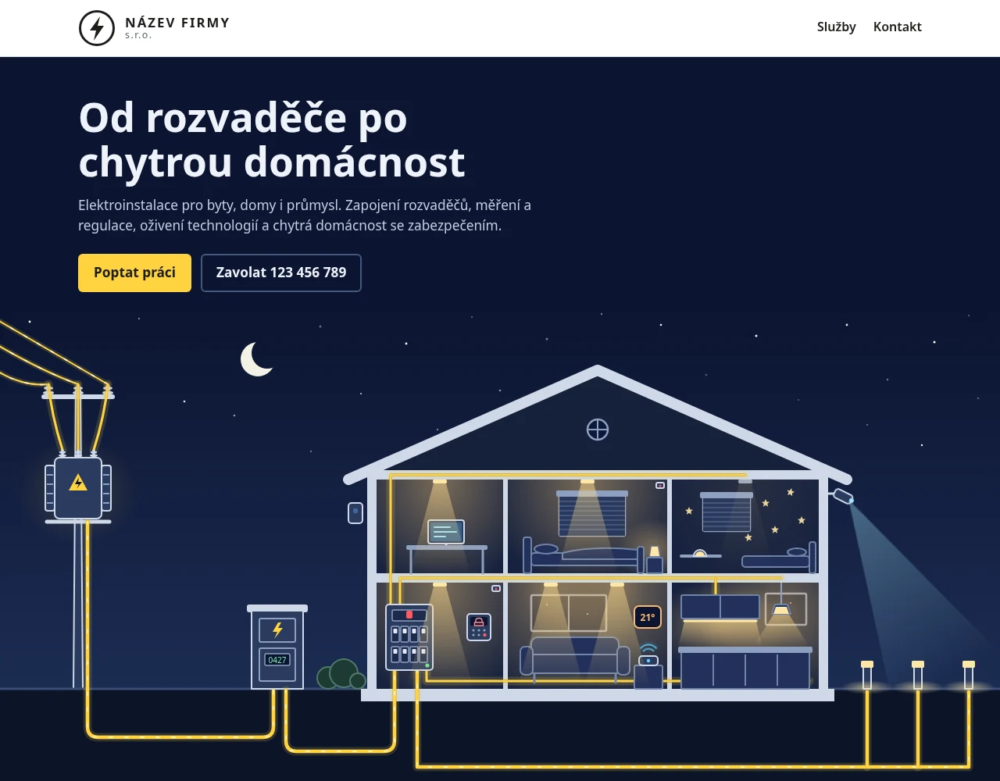

# Šablona webu pro elektrikáře

*A free (CC0) one-page website template for an electrician, in Czech, with an SVG animation of electricity flowing from a transformer into a smart home. Plain HTML, CSS, SVG and JavaScript, no dependencies.*

Jednostránkový web pro elektrikáře nebo malou elektro firmu. Na úvodní stránce je animace: proud teče z trafostanice přes přípojku s elektroměrem do rozvaděče v domě. Pak se postupně rozsvítí světla, rozjede se chytrá domácnost a zapne se zabezpečení.



**Šablona je úplně volná.** Použijte ji k čemukoli, i komerčně, upravte si ji podle sebe a autora uvádět nemusíte. Je uvolněná jako volné dílo podle [CC0 1.0](LICENSE).

Vznikla pro web [smartte.eu](https://smartte.eu). Logo a údaje té firmy v šabloně nejsou.

## Co v ní je

- `index.html`: celý web v jednom souboru, tedy HTML, CSS, scéna v SVG a JavaScript. Nepotřebuje žádné knihovny ani soubory odjinud a nepoužívá cookies. Má 39 kB, gzipem 11 kB.
- `favicon.svg`: zástupná ikona, blesk v kruhu.

## Jak ji použít

1. V `index.html` nahraďte zástupné údaje:
   - `Název firmy` v titulku stránky, v hlavičce, v kontaktech a v patičce;
   - telefon `+420 123 456 789` a `123 456 789`, včetně odkazů `tel:+420123456789`;
   - e-mail `info@example.com`;
   - sídlo, IČO a zápis v obchodním rejstříku v kontaktech a v patičce. Podle § 435 občanského zákoníku musí web podnikatele uvádět aspoň firmu a sídlo.
2. Vyměňte logo. V hlavičce je blesk jako SVG přímo v `index.html`, ikona prohlížeče je ve `favicon.svg`.
3. Upravte texty služeb.
4. Nahrajte `index.html` a `favicon.svg` na jakýkoli webhosting. Server nemusí umět nic víc než posílat soubory.

## Animace

- Je to SVG a Web Animations API, bez knihoven.
- Spustí se, až je scéna aspoň z třetiny vidět, a mimo obrazovku se zastaví.
- Kdo má v systému omezený pohyb (`prefers-reduced-motion`), uvidí rovnou hotový stav. Stejně tak prohlížeč bez JavaScriptu.
- Na mobilu je scéna větší a pohled jede za proudem od trafa k domu.
- Pod scénou je šest kroků s popisky a tlačítko Přehrát znovu.
- `?t=5000` v adrese zastaví scénu v daném čase v milisekundách. Hodí se na snímky obrazovky.

## HTTPS

Přesměrování z http na https patří do nastavení serveru. Někde ale HTTPS ukončuje proxy před Apachem, třeba na freehostingu Subregu. Apache tam každý požadavek vidí jako http, takže `.htaccess` s podmínkou `%{HTTPS}` přesměrovává pořád dokola, i na https. Na takovém hostingu stačí dát na začátek `<head>`:

```html
<script>
if (location.protocol === 'http:') location.replace('https:' + location.href.slice(5));
</script>
```
